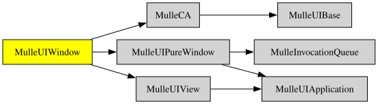

# MulleUIWindow

#### 🛸 MulleUIWindow provides UIWindow and extends UIView functionality


See live on stream how it progresses: [https://www.twitch.tv/mulle_kybernetik_tv/](). Every Wednesday at 14:00-18:00 CEST.


There is no actual "drawing" code in MulleUIWindow. Use "MulleGraphics" for
drawing. See "MulleUIControl" for widgets.


| Release Version                                       | Release Notes  | AI Documentation
|-------------------------------------------------------|----------------|---------------
|  [](//github.com/MulleUI/MulleUIWindow/actions) | [RELEASENOTES](RELEASENOTES.md) | [DeepWiki for MulleUIWindow](https://deepwiki.com/MulleUI/MulleUIWindow)


# Introduction to MulleUIWindow Framework

The MulleUIWindow framework offers a robust and flexible approach to building user interfaces. It provides a hierarchical structure that elegantly separates concerns between drawing, event handling, and overall management. Let's dive into the key components and their relationships.

## UIWindow: The Grand Orchestrator

At the pinnacle of our UI hierarchy stands UIWindow. Think of it as the conductor of an orchestra, coordinating all the visual elements of your application. UIWindow is responsible for:

- Managing the overall screen real estate
- Coordinating the display of content
- Serving as the root container for your application's user interface

## UIView: The Interactive Canvas

UIView objects are the true workhorses of your user interface. They're like talented musicians in our orchestra, each playing a crucial role. UIViews are responsible for:

- Handling user interactions
- Responding to events
- Managing the layout of their subviews
- Interpreting user input
- Updating the visual representation based on user actions

UIViews form the backbone of your application's interactive elements, ensuring a responsive and engaging user experience.

## CALayer (or id <UILayer>): The Visual Virtuoso

The CALayer (or id <UILayer>) protocol is our framework's artistic specialist. It's solely dedicated to drawing and visual representation, much like a master painter focused entirely on creating stunning visuals. Key aspects include:

- Exclusive focus on drawing and rendering
- No handling of user interactions or event interpretation
- Efficient rendering and animation capabilities

This separation of concerns allows for a more streamlined and performant visual layer.

## Key Architectural Points

1. **Clear Separation of Responsibilities**:
   - UIView: Interaction and layout
   - CALayer: Drawing and animation

2. **Controller as the Maestro**:
   Controllers act as managers for one or multiple views, much like a conductor guiding different sections of an orchestra. They coordinate behavior and data flow, ensuring all parts work in harmony.

3. **Innovative Process Design**:
   The animation and drawing of layers are cleverly designed to potentially run in a separate process. This architectural choice:
   - Limits or eliminates callbacks to view code
   - Enhances overall performance
   - Enables smoother animations
   - Provides a clear boundary between visual rendering and logical operations

## The Symphony of UI Components

By orchestrating these elements - UIWindow, UIView, and CALayer - the MulleUIWindow framework creates a symphony of UI components. This structure offers developers a powerful and flexible toolkit for crafting complex, efficient, and visually appealing user interfaces.

The framework's design philosophy emphasizes clarity, performance, and separation of concerns, allowing developers to create harmonious and responsive applications with ease.

- UIWindow (at the top)
  |
  +-- Controller 1
  |   |
  |   +-- UIView 1
  |   |   |
  |   |   +-- CALayer 1
  |   |
  |   +-- UIView 2
  |       |
  |       +-- CALayer 2
  |       +-- CALayer 3
  |       +-- CALayer 4
  |
  +-- Controller 2
      |
      +-- UIView 3
          |
          +-- CALayer 5

### You are here




## Add

Use [mulle-sde](//github.com/mulle-sde) to add MulleUIWindow to your project:

``` sh
mulle-sde add github:MulleUI/MulleUIWindow
```

To only add the sources of MulleUIWindow with dependency
sources use [clib](https://github.com/clibs/clib):


``` sh
clib install --out src/MulleUI MulleUI/MulleUIWindow
```

Add `-isystem src/MulleUI` to your `CFLAGS` and compile all the sources that were downloaded with your project.


## Install

Use [mulle-sde](//github.com/mulle-sde) to build and install MulleUIWindow and all dependencies:

``` sh
mulle-sde install --prefix /usr/local \
   https://github.com/MulleUI/MulleUIWindow/archive/latest.tar.gz
```

### Legacy Installation

Install the requirements:

| Requirements                                 | Description
|----------------------------------------------|-----------------------
| [MulleUIPureWindow](https://github.com/MulleUI/MulleUIPureWindow)             | 👁️‍🗨️ MulleUIPureWindow - Windows without Views
| [MulleUIView](https://github.com/MulleUI/MulleUIView)             | 
| [MulleCA](https://github.com/MulleUI/MulleCA)             | 🍃 Animate properties in real time with mulle-objc
| [mulle-objc-list](https://github.com/mulle-objc/mulle-objc-list)             | 📒 Lists mulle-objc runtime information contained in executables.

Download the latest [tar](https://github.com/MulleUI/MulleUIWindow/archive/refs/tags/latest.tar.gz) or [zip](https://github.com/MulleUI/MulleUIWindow/archive/refs/tags/latest.zip) archive and unpack it.

Install **MulleUIWindow** into `/usr/local` with [cmake](https://cmake.org):

``` sh
PREFIX_DIR="/usr/local"
cmake -B build                               \
      -DMULLE_SDK_PATH="${PREFIX_DIR}"       \
      -DCMAKE_INSTALL_PREFIX="${PREFIX_DIR}" \
      -DCMAKE_PREFIX_PATH="${PREFIX_DIR}"    \
      -DCMAKE_BUILD_TYPE=Release &&
cmake --build build --config Release &&
cmake --install build --config Release
```


## Author

[Nat!](https://mulle-kybernetik.com/weblog) for Mulle kybernetiK  


